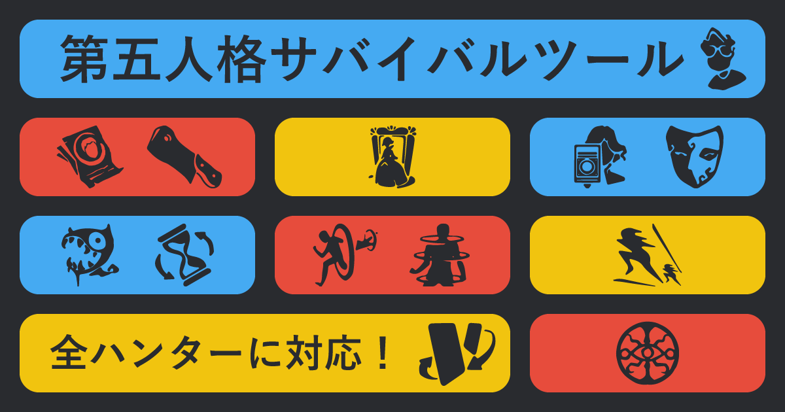

# 第五人格サバイバルツール

Identity V（第五人格）の対戦中に使う、サバイバー向けの非公式タイマー・情報管理ツールです。ハンターのスキルや特質のクールタイム、対戦経過時間、人格の選択状況を画面上で管理できます。

**デモ:** [日本語版](https://koniooo.github.io/IdentityV-SurvivalTool/) / [English](https://koniooo.github.io/IdentityV-SurvivalTool/en)



## 開発背景

対戦中にハンターのスキルや特質の再使用可能時刻、対戦経過時間を把握する作業を補助するために制作しました。選択したハンターに応じたクールタイムを表示し、対戦中の時間管理と情報確認をひとつの画面で行えることを目指しています。

## 主な機能

- 日本語・英語の表示切り替え
- ハンターの選択と、登録データに基づくスキル名・クールタイムの表示
- 複数段階のクールタイムを持つスキルへの対応
- 対戦開始前カウントダウンと対戦経過時間の管理
- 特質（巡視者・瞬間移動・興奮）のクールタイム管理
- 人格（封鎖・指名手配・引き留めるなど）の選択状態の記録
- 夢の魔女の攻撃に応じたスキルタイマーの調整

## 技術スタック

| 分類             | 技術                                      |
| ---------------- | ----------------------------------------- |
| フレームワーク   | Next.js（Pages Router、静的エクスポート） |
| UI               | React                                     |
| 言語             | TypeScript                                |
| スタイル         | Sass / SCSS Modules                       |
| テスト           | Vitest                                    |
| コード品質・整形 | ESLint、Prettier                          |
| デプロイ         | GitHub Pages、GitHub Actions              |

## 技術的な工夫

- **日英ページでUIロジックを共有:** 言語をコンポーネントへ渡し、共通のタイマーUIで表示文言を切り替えています。翻訳が必要な文字列と、言語に依存しないクールタイムのデータを分けて管理しています。
- **タイマー処理をカスタムフックに分離:** `useTimer` にカウントダウン処理をまとめ、複数のタイマーから再利用しています。
- **GitHub Pages向けに静的出力:** Next.jsの静的エクスポートを使い、GitHub Actionsからビルド成果物をデプロイしています。
- **計算ロジックをUIから分離してテスト:** クールタイムの合計計算を独立した関数にし、Vitestで正常系と不正な入力をテストしています。

## ローカルでの実行

デプロイ用ワークフローと同じ **Node.js 26** と npm を使用してください。

```bash
npm ci
npm run dev
```

開発サーバーの起動後、[http://localhost:3000](http://localhost:3000) を開きます。英語版は `/en` です。

### 主な確認コマンド

```bash
npm run lint
npm test
npm run build
npx prettier --check .
```

Prettierで整形する場合は `npx prettier --write .` を実行します。このコマンドは対象ファイルを書き換えます。

Vitestのテスト対象は、現在クールタイム合計計算のユニットテストです。アプリ全体のUIやタイマー操作を網羅するテストではありません。

## ディレクトリ構成

```text
src/
├── components/   # 画面を構成するReactコンポーネント
├── hooks/        # 再利用するReactフック
├── lib/          # ハンターのデータ、計算ロジック、テスト
├── pages/        # 日本語版・英語版のページ（Next.js Pages Router）
└── styles/       # グローバルスタイル、共通デザイントークン
```

## デプロイ

`master` ブランチへのpush、またはGitHub Actionsからの手動実行で、GitHub Pages向けの静的ビルドとデプロイを行います。

## 権利表記

本ツールは非公式のファン制作物であり、Identity V（第五人格）の運営会社・権利者とは関係ありません。ゲーム名、キャラクター名、その他の関連する名称・素材の権利は各権利者に帰属します。
